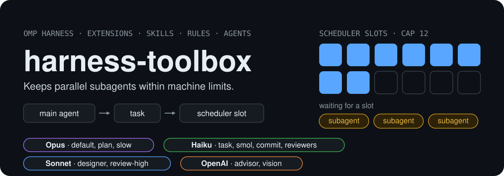
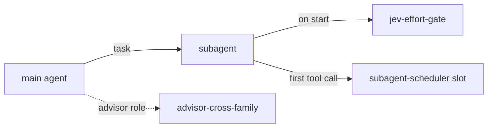

<p align="center">
  
</p>

# harness-toolbox

Extensions, skills, rules, and agents for the `omp` coding harness. Each piece is independent; load only what you use.

## Setup

### Model roles

Values come from `config/roles.example.yml`. The suffix after `:` is the thinking effort.

| Role | Model | Fallback chain |
|---|---|---|
| `default`, `plan` | `anthropic/claude-opus-5-5:medium` | `openai-codex/gpt-6.2-sol` |
| `slow` | `anthropic/claude-opus-5-5:high` | `openai-codex/gpt-6.2-sol` |
| `task` | `anthropic/claude-haiku-5-5:high` | `openai-codex/gpt-6.2-sol` |
| `designer` | `anthropic/claude-sonnet-5-5:medium` | `openai-codex/gpt-6.2-sol` |
| `smol` | `anthropic/claude-haiku-5-5:low` | `openai-codex/gpt-6-luna`, `openai-codex/gpt-6.2-sol`, `anthropic/claude-sonnet-5-5` |
| `commit` | `anthropic/claude-haiku-5-5:low` | `openai-codex/gpt-6.2-sol` |
| `tiny` | `anthropic/claude-haiku-5-5:off` | `openai-codex/gpt-6-luna`, `openai-codex/gpt-6.2-sol`, `anthropic/claude-sonnet-5-5` |
| `vision` | `openai-codex/gpt-5.6-terra:medium` | `anthropic/claude-sonnet-5-5`, `openai-codex/gpt-6.2-sol` |
| `advisor` | `openai-codex/gpt-6.2-sol:high` | `openai-codex/gpt-6.2-sol` |

Agent overrides under `task.agentModelOverrides`:

| Agent | Model |
|---|---|
| `task-fast` | `anthropic/claude-sonnet-5-5:high` |
| `scout` | `anthropic/claude-sonnet-5-5:low` |
| `reviewer`, `readonly-reviewer` | `anthropic/claude-haiku-5-5:high` |
| `review-low` | `anthropic/claude-haiku-5-5:low` |
| `review-high`, `repo-audit` | `anthropic/claude-sonnet-5-5:medium` |
| `sonic` | `openai-codex/gpt-6-luna:medium` |
| `librarian` | `openai-codex/gpt-6-luna:low` |

### Session flow



- `jev-effort-gate` runs when a subagent starts. It moves only `task`, one effort level at most, within `low`–`high`.
- A subagent takes a scheduler slot at its first tool call. It releases the slot on a `task`, `wait`, or `eval` call and when its run ends.
- `advisor-cross-family` runs at session start and after a fallback is applied. It picks the first of `openai-codex/gpt-6-luna`, `deepseek/deepseek-v4-flash` in a different family from the live model. Subagent sessions skip it.

### Guards

| Guard | Extension | Rule |
|---|---|---|
| Search budget | `search-guard` | 15 `web_search` calls per session, shared by the main agent and its subagents. The 16th is blocked. A result starting with `Error:` forbids retries. |
| Read-only reviewers | `readonly-lsp` | `readonly-reviewer`, `review-high`, and `review-low` may use only lookup `lsp` actions such as `definition`, `references`, and `hover`. |
| Effort gate | `jev-effort-gate` | Raises `task` one level for an exhaustive request without a named target, unless provider quota is at 95%. Drops it one level for an exact or urgent request, or when quota reaches 80%. Other agents keep their configured level. |

### Machine

- Tuned on a macOS laptop. The scheduler's cap signals (`iostat`, `vm_stat`, `sysctl`, and a spawn probe) are macOS tools.
- The cap starts at 12 and moves between 1 and 32 from CPU idle, free memory, swapping, memory pressure, and spawn latency.
- `SUBAGENT_SCHEDULER_SLOTS=<n>` fixes the cap on any platform. Details: [Subagent scheduler](#subagent-scheduler).

## Requirements

| Requirement | Needed for |
|---|---|
| `omp` harness | Everything in this repo |
| Bun | `bun run test`, `flame-graph` |
| Perl 5 | `src/subagent-scheduler.pl`, `perl test/subagent-scheduler.t` |
| macOS | Adaptive scheduler cap: it reads `iostat`, `vm_stat` and `sysctl kern.memorystatus_vm_pressure_level`. Elsewhere set `SUBAGENT_SCHEDULER_SLOTS` to a fixed cap. |
| Python 3 and `uv` | Bench scorers and the SkillOpt trainers |
| `flamegraph.pl` | `flame-graph` skill (`brew install flamegraph`) |
| `TYPESAFE_API_KEY` | Jev signals in `jev-effort-gate` (fails open without it) and `bench/small/replay.py` |

## Install

1. Add the extensions and skill directory to `~/.omp/agent/config.yml`:

```yaml
extensions:
  - /path/to/harness-toolbox/extensions/search-guard.ts
  - /path/to/harness-toolbox/extensions/advisor-cross-family.ts
  - /path/to/harness-toolbox/extensions/jev-effort-gate.ts
  - /path/to/harness-toolbox/extensions/readonly-lsp.ts
  - /path/to/harness-toolbox/extensions/worker-skill-trim.ts
  - /path/to/harness-toolbox/extensions/subagent-scheduler.ts
  - /path/to/harness-toolbox/extensions/git-chores-fast-path.ts
  - /path/to/harness-toolbox/extensions/reviewer-diff-guard.ts
  - /path/to/harness-toolbox/extensions/progress.ts
extensionHandlers:
  toolCallTimeoutMs: 600000
skills:
  customDirectories:
    - /path/to/harness-toolbox/skills
```

2. Set the search timeout in the same file. Under parallel load the search provider chain takes about a minute per failed call:

```yaml
providers:
  webSearchTimeoutSeconds: 30
```

3. Link the rules and the compatibility skill as startup rules:

```sh
mkdir -p ~/.omp/agent/rules
ln -s /path/to/harness-toolbox/skills/ponytail-compatibility/SKILL.md ~/.omp/agent/rules/ponytail-compatibility.md
ln -s /path/to/harness-toolbox/rules/code.md ~/.omp/agent/rules/code.md
ln -s /path/to/harness-toolbox/rules/writing.md ~/.omp/agent/rules/writing.md
```

4. Link the agents and commands into the user agent directory:

```sh
mkdir -p ~/.omp/agent/agents ~/.omp/agent/commands
for agent in task readonly-reviewer review-high review-low task-fast repo-audit bench-runner git-chores; do
  ln -s /path/to/harness-toolbox/agents/$agent.md ~/.omp/agent/agents/$agent.md
done
ln -s /path/to/harness-toolbox/commands/eli5.md ~/.omp/agent/commands/eli5.md
```

5. For `flame-graph`, install the renderer:

```sh
brew install flamegraph
```

6. Optional: merge `config/roles.example.yml` into `~/.omp/agent/config.yml` for the model roles, agent overrides, and fallback chains chosen from the bench results.

7. Restart the harness.

## Extensions

| Name | File | What it does |
|---|---|---|
| search-guard | `extensions/search-guard.ts` (logic: `src/guard-core.ts`) | Caps `web_search` at 15 calls per session, rewrites `Error:` results to forbid retries, and injects the search policy at agent start. |
| advisor-cross-family | `extensions/advisor-cross-family.ts` | Moves the advisor role to another model family when the live model changes provider. Checks the configured role, not the model a fallback chain lands on. |
| jev-effort-gate | `extensions/jev-effort-gate.ts` | Moves a subagent's thinking effort one step when it starts (`task`, eval `agent()`, and workpool spawns), from Jev signals on its assignment and provider quota. Other agents keep their configured level. Logs each decision as a `harness-toolbox.jev-effort-gate` session entry. |
| readonly-lsp | `extensions/readonly-lsp.ts` | Limits `lsp` for `readonly-reviewer`, `review-high`, and `review-low` to lookup actions. Required by those agents. |
| worker-skill-trim | `extensions/worker-skill-trim.ts` | Removes the `<skills>` catalog from subagent system prompts. Workers still load a skill by name through `skill://<name>`. |
| subagent-scheduler | `extensions/subagent-scheduler.ts` | Makes every subagent wait for a machine-wide slot before its first tool call. See [Subagent scheduler](#subagent-scheduler). |
| progress | `extensions/progress.ts` (logic: `src/progress-core.ts`) | Shows a widget above the editor while agents work: one line per agent, main and subagents, with a todo progress bar (done/total) and sparklines of output tokens per second and tool calls over the last two minutes. Subagents have no todo tool by default, so their line shows elapsed time instead. Reads subagent activity from omp's `task:subagent:event` frames. Hides after one minute without activity; a finished subagent's line stays 30 seconds. Interactive TUI only. |
| git-chores-fast-path | `extensions/git-chores-fast-path.ts` | Does a one-path ignore, exclude, or untrack `git-chores` task itself when Jev is confident, and blocks the spawn with the result. Runs only from the repo root, with an explicit ignore or untrack ask and no commit, push, delete, or other agent-only job. Falls back to the agent on any doubt or Jev error, or without `TYPESAFE_API_KEY`. |
| git-chores-fast-path | `extensions/git-chores-fast-path.ts` | Does a one-path ignore, exclude, or untrack `git-chores` task itself when Jev is confident, and blocks the spawn with the result. Runs only from the repo root, with an explicit ignore or untrack ask and no commit, push, delete, or other agent-only job. Falls back to the agent on any doubt, a Jev error, a failed git action, or without `TYPESAFE_API_KEY`. Each `git-chores` task call appends one JSON line to the file named by the `GIT_CHORES_FAST_PATH_LOG` env var (default `~/.omp/agent/git-chores-fast-path.jsonl`): `ts`, `outcome` (`fast` or `agent`), `reason`, `label`, `confidence`, `ms`, and `path` when the fast path acted on it. |
| reviewer-diff-guard | `extensions/reviewer-diff-guard.ts` | Blocks a `task` call that spawns `readonly-reviewer`, `review-high`, or `review-low` with no diff in its task or context, so the parent resends it instead of paying for a `BLOCKED: no diff supplied` reply. Any mention of a diff or patch, a hunk, a `local://` or `pr://` reference, a README, or a whole-repo review lets it through. |

## Skills

| Name | File | What it does |
|---|---|---|
| search-hang | `skills/search-hang/SKILL.md` | Anti-hang policy for agents that read skills. |
| ponytail-compatibility | `skills/ponytail-compatibility/SKILL.md` | Makes applicable workflows and agent roles take precedence over conflicting Ponytail instructions of equal authority. |
| omp-config | `skills/omp-config/SKILL.md` | Changes omp settings (roles, overrides, fallback chains, efforts), reads each key back with `omp config get`, and mirrors keys an example config already tracks. Never commits. |
| flame-graph | `skills/flame-graph/SKILL.md` | Draws a flame graph SVG of a process (`sample`, `py-spy`), a session or one agent in it (`src/session-flame.ts`: wall time, tokens, or cost), or any hierarchy with a number per leaf. For a session it also writes a trace-event timeline. Needs `flamegraph.pl` and `bun`. |
| eli5-codebase | `skills/eli5-codebase/SKILL.md` | Explains a codebase feature in three sections (What it is, Where it lives, How to use it) with an analogy, one sequence diagram, a file and symbol table, and a setup block. States only paths, symbols and commands confirmed in the code. |
| crossroads-survey | `skills/crossroads-survey/SKILL.md` | Finds closed-choice picks in a repo's prompts, harness code, product code and session history; classifies them with a decision model (Jev); ranks them; pilots the top ones; writes `bench-runner` directories (`src/crossroads/survey.ts`). Needs `bun`, `ast-grep` and `TYPESAFE_API_KEY`. |

## Commands

| Name | File | What it does |
|---|---|---|
| `/eli5 [feature]` | `commands/eli5.md` | Runs the `eli5-codebase` skill on the named feature. No feature, or one that matches nothing: offers a menu of the repo's features to pick from. |

## Rules

| Name | File | What it does |
|---|---|---|
| code | `rules/code.md` | Comment, readability, dependency, and repository portability constraints. |
| writing | `rules/writing.md` | Reader-facing document formats and ticket limits. |

## Agents

| Name | File | What it does |
|---|---|---|
| readonly-reviewer | `agents/readonly-reviewer.md` | Read-only change review: spec and standards axes kept separate, then correctness, security, performance, and tests. Needs the diff passed in, or a README or whole-repo review that names the files to read. |
| review-high, review-low | `agents/review-high.md`, `agents/review-low.md` | `readonly-reviewer` at high and low thinking. Bodies must stay identical to `readonly-reviewer`. |
| task | `agents/task.md` | Overrides the bundled `task`. Its scope covers every spec violation the assignment names, so it fixes what it notices instead of reporting it. |
| task-fast | `agents/task-fast.md` | `task` worker for when wall-clock time matters. Pair with a faster, costlier model in `task.agentModelOverrides`. Body must stay identical to `agents/task.md`. |
| repo-audit | `agents/repo-audit.md` | Read-only whole-repo audit: doc/code drift, inconsistency, dead code, inefficiency, and untested behavior. Writes a report only to a path the caller names. |
| bench-runner | `agents/bench-runner.md` | Runs a bench matrix through the repo's own run and score scripts in parallel. Waits out quota limits instead of switching models, discards runs answered by another model, and regenerates the report page. |
| git-chores | `agents/git-chores.md` | Gitignore and exclude, untrack, prune worktrees and caches, commit, and push. Refuses history rewrites, force pushes, and `--no-verify` unless the assignment names them. |

## Config and bench

| Name | Path | What it does |
|---|---|---|
| role map | `config/roles.example.yml` | Model roles, agent overrides, fallback chains, and compaction thresholds chosen from the bench results. |
| review bench | `bench/review/` | Runs `readonly-reviewer` on diffs with planted bugs and behavior-preserving decoys. Scores recall, decoys flagged, cost, and time per model and effort. |
| small-role bench | `bench/small/` | Scores a tool-call fix, a commit subject, the bundled scout prompt, a multi-file spec fix with a decoy file, an exploration fix, and a find-every-caller fix, per model and effort. |
| gate tuning | `bench/skillopt/` | Trains `jev-effort-gate`'s Jev questions with SkillOpt against recorded `bench/small` runs. `report.py` writes a live HTML report. |
| scheduler bench | `bench/scheduler/` | Throughput bench for `src/subagent-scheduler.pl`. See `bench/scheduler/README.md`. |

## Tests

```sh
bun run test
```

| File | Checks |
|---|---|
| `test/simulate.ts` | search-guard budget under the load scenario |
| `test/wiring.ts` | each extension against a fake harness API; `readonly-lsp` list matches each agent's tools |
| `test/effort-policy.ts` | `jev-effort-gate` level policy and child-side hook |
| `test/session-flame.ts` | folded stacks and timeline built from a session transcript |
| `test/progress.ts` | progress widget's todo bar, time buckets and line |
| `test/subagent-scheduler.t` | subagent scheduler (Perl) |

## Bench

Each run uses `omp -p` with retries, model fallback, and the advisor off (`bench/overlay.yml`). Runs spend subscription quota and take 10–40 s each.

```sh
bench/review/run.sh <case> anthropic/claude-haiku-5-5:low <rep> [agent|prompt-file]
```

```sh
bench/small/run.sh <tools|commit|scout|task|explore|callers|expiry|guard> anthropic/claude-haiku-5-5:low <rep> [variant]
```

`bench/small/run.sh` reads `RUN_TAG`, `AGENT_PROMPT`, and `PROMPT_ONLY` from the environment.

```sh
python3 bench/review/score.py [case ...]
```

```sh
python3 bench/small/score.py
```

```sh
TYPESAFE_API_KEY=... python3 bench/small/replay.py
```

SkillOpt needs its own virtualenv first:

```sh
uv venv bench/.venv && uv pip install --python bench/.venv/bin/python -r bench/skillopt/requirements.txt
```

| Trainer | Command | Reward |
|---|---|---|
| gate | `(cd bench/skillopt && ../.venv/bin/python train.py --config config.yaml)` | Recorded `bench/small` run outcomes |
| reviewer | `(cd bench/skillopt && ../.venv/bin/python train_review.py --config review.yaml)` | Recall − 0.25 × decoys flagged |
| task | `(cd bench/skillopt && ../.venv/bin/python train_task.py --config task.yaml)` | Hidden checks passed − 0.25 × decoy edited |

Limits:
- Each scorer fails when a run was answered by a model other than the one requested.
- A decoy must be a change no reviewer can reasonably flag. A removed guard in an exported function is a defect under a "no behavior change" spec.
- Training needs 15+ cases where the target effort still misses defects. With fewer, SkillOpt memorises case details.
- `train_review.py` produced a prompt on Haiku low that scored lower than the current prompt on unseen cases. The reviewer agents keep their hand-written prompt.

Recorded results:
- Review bench: 17 cases. Haiku high finds 92–100% of planted defects on each and flags no decoy. Haiku low trails by 8–12 points on 6 cases.
- `task` agent on `bench/small`, Haiku, hard passes against the bundled `task`: low 180/234 vs 166/234, medium 131/162 vs 129/162, high 138/162 vs 132/162.
- Held-out fixtures (`explore`, `task`, `tools`), same comparison: low 69/90 vs 67/90, medium 75/90 vs 74/90, high 81/90 vs 76/90.

## Subagent scheduler

- A subagent takes a slot at its first tool call and holds it until its run ends. A subagent that never calls a tool takes no slot.
- A subagent releases its slot while it calls `task`, `wait`, or `eval`. The slot frees when the command exits, even if it leaves background children running.
- The main session and subagents inside a bench run are not queued. A bench run holds one slot for its whole omp process.
- The cap starts at 12 and adapts every 2 s:
  - grows by 1 while runs wait, CPU idle is at least 25%, and at least 15% of memory is free;
  - drops to a quarter below the runs in flight on swapping, memory pressure, a no-op taking over 40 ms to spawn, or CPU idle under 10% for two samples;
  - does not drop again until runs above the new cap have finished.
- Changes are logged to `~/.cache/subagent-scheduler/control.log`.
- `SUBAGENT_SCHEDULER_SLOTS=<n>` fixes the cap and turns adaptation off.
- `extensionHandlers.toolCallTimeoutMs` must exceed the longest expected wait.

## Behavior and limits

- **search-guard**: subagents share one budget. The 16th `web_search` call in a session is blocked with a read-the-URLs reason. The retry ban applies only to results that start with `Error:`.
- **advisor-cross-family**: runs at session start and on `retry_fallback_applied`. Subagent sessions are skipped. It reads the configured role, so a review that a fallback chain lands in the primary's family goes unfixed; with an openai primary, the advisor chain's last entry `gpt-6.2-sol` is such a case. When neither preference resolves in another family, the advisor is left unchanged. The openai-primary path has not been run end to end.
- **readonly-lsp**: blocks by agent name, so a reviewer copied under another name gets an unrestricted `lsp`. Add the name to `READONLY_AGENTS`. `test/wiring.ts` fails when an agent has `lsp` without `edit`, `write`, or `bash` and is not listed.
